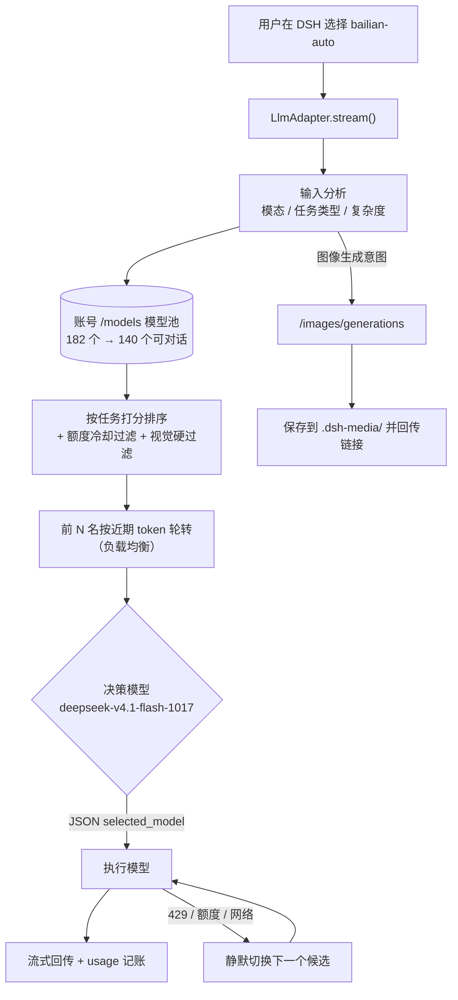

<div align="center">

# dsh-bailian-auto-router

**百炼智能路由 · Aliyun Bailian auto-router for DeepSeek Harness**

[](LICENSE)
[](https://www.typescriptlang.org/)
[](https://github.com/deepseek-ai/deepseek-harness)
[](https://nodejs.org/)

在 DSH 的模型选择器里注册一个虚拟模型 **`bailian-auto`(百炼智能路由)**:
每次请求先由决策模型分析输入,再路由到**你账号下**最合适的百炼执行模型。

</div>

---

## 特别声明:本插件是 provider 之上的一层路由

本插件**不实现 Provider**,而是 `dsh-aliyun-bailian-provider` 的**上层路由**:

| 层次 | 职责 |
|---|---|
| Provider 层(`dsh-aliyun-bailian-provider` / DSH 内置 `llm-pi-ai`) | 把阿里云百炼的 OpenAI 兼容端点接入 DSH:端点、凭据、模型注入、chat-completions 协议 |
| **本插件(路由层)** | 在 provider 之上做**请求前决策**、账号模型池管理、负载均衡、思考档位、额度冷却与静默回退 |

因此:

- **需要能访问百炼的 provider 才能工作**。本机该 provider 由 DSH profile 中的 `llm-pi-ai` 以 `bailian` 路由承担,并已被本插件自动发现并沿用其接口与凭据;
- 本插件**不 `import` 任何名为 `dsh-aliyun-bailian-provider` 的包**(它可能并未单独安装),只通过 `ctx.llm` 与 HTTP 端点协作,因此不会因为缺少该包而报错;
- 若你尚未配置百炼 provider,请先在 **设置 → 模型** 里配置一个指向 `https://dashscope.aliyuncs.com/compatible-mode/v1`(或你的 workspace 端点)的 OpenAI 兼容 provider。

## 核心特性

| 特性 | 说明 |
|---|---|
| **请求前主动决策** | 决策模型(默认 `deepseek-v4.1-flash-1017`)分析模态(文本/图片/代码)与任务类型(写作/推理/翻译/代码/图片分析),返回 `{"selected_model","reasoning"}`;失败则用回退模型或启发式排序 |
| **账号模型池** | 池成员 = 当前账号 `GET /models` 的返回(实测 182 个 → 140 个可对话),`/models` 之外的 id 不会被虚构;内置目录只提供元数据 |
| **负载均衡** | 同一任务在排名前 N 的同类模型间按**近期 token 消耗**轮转,不会每次 code 都打同一个旗舰 |
| **思考档位自适应** | `auto` 按任务复杂度自动在 `off/low/medium/high/max` 间切换,也可手动锁定 |
| **额度冷却 + 静默回退** | 429/额度耗尽/网络错误在**未输出内容前**静默换模型;已输出内容后失败则直接报错,不重复输出 |
| **媒体路由** | "画一张…"→ 调 `/images/generations`,成品存进工作区 `.dsh-media/` 并回传 Markdown 链接 |
| **视频能力闸门** | 识别"生成视频/短片/动画"但账号没有视频模型时,**零 token** 直接回复能力说明与替代方案;带"脚本/分镜/提示词/封面/剪辑/PPT"等产物名词的请求不会被误短路 |
| **会话粘模型** | 同一 `sessionId` 固定首选模型(保住 prompt cache 与 tool-call 格式),每 N 轮(默认 8)允许重选以保持均衡;无 `sessionId` 时降级为请求级轮转 |
| **换账号无需改配置** | 端点/凭据变化自动重置模型池与冷却;配置的模型不存在时自动替代并在面板提示 |
| **零运行时依赖** | 不需要 `node_modules` 即可安装运行,不会因缺包激活失败 |

## 架构:决策模型路由



决策顺序(每一步都可降级,任何一步失败都不会卡住对话):

1. **输入分析** — 统计图片块、代码密度、推理类词汇、已执行工具步数,得到任务类型与 0–100 复杂度;
2. **池与过滤** — 非对话端点(TTS/ASR/向量化/重排/图像生成)按能力分流;图片请求只留视觉模型;冷却中的模型排到回退链尾部;
3. **排序 + 均衡** — 按家族/规模/档位/任务亲和度打分,取前 N 名按近期 token 消耗轮转;
4. **决策模型** — 只在候选窗口内选择,返回的 id 不在窗口内视为无效,回落启发式;
5. **执行** — 流式转发;失败则按错误码决定"换模型"还是"直接报错"。

## 安装

```sh
# 本地目录（开发/自用，link 方式）
dsh plugin --profile web add link:/path/to/dsh-bailian-auto-router

# GitHub 仓库
dsh plugin --profile web add github:interested3041/dsh-bailian-auto-router

# 本地已 clone 的目录
dsh plugin --profile web add /path/to/dsh-bailian-auto-router
```

安装后**重启** `dsh web` / Desktop(宿主插件的新模块版本需要重启加载)。

凭据:默认按 `BAILIAN_API_KEY` → `DASHSCOPE_API_KEY` → `ALIYUN_API_KEY` 依次查找
(DSH 凭据服务优先,其次启动环境变量)。

## 配置

三种方式等价:插件页面板、profile 的 `cordis.patch.yml`、或凭据服务/环境变量。

| 字段 | 默认 | 说明 |
|---|---|---|
| `decisionModel` | `deepseek-v4.1-flash-1017` | 决策模型;**不在当前账号时自动替代** |
| `fallbackModel` | `deepseek-v4.1-flash-1017` | 决策失败时的回退执行模型 |
| `decisionTimeoutMs` | `12000` | 决策超时,超时即回退 |
| `maxAttempts` | `4` | 单请求最多尝试的模型数 |
| `taskRoutes` | 内置表 | 各任务类型的**首选**模型(其后的由打分决定) |
| `models` | `[]` | 自定义执行模型池(JSON),可覆盖视觉/上下文/标签 |
| `excludeModels` | `[]` | 排除规则,支持 `前缀*` 通配 |
| `balanceStrategy` | `balanced` | `balanced` 按 token 轮转;`quality` 始终用最优 |
| `balanceWindow` | `6` | 参与轮转的候选个数 |
| `balanceBand` | `0` | 分数保护带(0=关闭),避免旗舰与低价小模型混排 |
| `balanceWindowHours` | `24` | 用量统计窗口,超期自然衰减 |
| `thinkingEffort` | `auto` | 思考档位策略:auto / off / low / medium / high / max |
| `enableDecision` | `true` | 关闭后仅按启发式规则路由 |
| `quotaCooldownMinutes` | `30` | 额度耗尽/不可调用模型的冷却时长 |
| `rateLimitCooldownSeconds` | `120` | 限流/网络类失败的冷却时长 |
| `enableMediaRouting` | `true` | 图像生成意图是否走 `/images/generations` |
| `stickySession` | `true` | 同一会话固定首选模型,保住 prompt cache 与 tool-call 格式;关闭后每请求按均衡轮转 |
| `sessionTurnLimit` | `8` | 同会话每 N 轮允许重选一次,避免长会话钉死单个模型;重选仍走均衡带 |
| `autoSyncPool` / `poolSyncIntervalHours` | `true` / `24` | 模型池自动同步 |

### 改决策模型 / 候选池

- **只换决策模型**:面板「决策模型」填任意你账号里存在的 id,保存即生效(volatile 字段无需重启);
- **只调某类任务的候选**:面板「各任务类型候选模型」按优先级填 id,逗号或换行分隔;
- **整体换池**:在「自定义模型池」粘贴 JSON 数组,`[{ "id": "...", "vision": true, "tags": ["code"] }]`;
- **想让某类任务只用固定模型**:`balanceStrategy=quality` + 该类候选只填一个 id。

### 换阿里云账号

面板「阿里云连接」会列出 profile 里所有阿里云兼容 provider,点「切到这个账号」即切换端点 + 凭据并重新同步池;旧账号的模型池与冷却会自动清空。配置的模型在新账号不存在时会自动替代并提示,配置值本身不被改写。

## 面板

- **插件页 → dsh-bailian-auto-router**:状态、连接切换、路由与容灾、均衡与思考档位、模型池构成、本地冷却状态(启发式,非真实配额)、最近 50 条路由决策;
- **设置 → 模型** 底部:一行状态卡片(模型池数量、冷却数量)。

## 测试

```sh
npm install
npm run build      # tsc(宿主 + 客户端两套 tsconfig)+ 校验 client.js 为经典脚本(不含 ESM 语法)
npm test           # 冒烟 + 分类/排序 + 路由 + 换账号 + 均衡/档位/媒体/视频闸门/会话粘,共 200+ 断言
npm run test:live  # 用本机真实凭据与端点跑通完整链路(46 项)
```

`lib/client.js` 必须能被浏览器当作**经典脚本**求值(它通过
`window.__ModuleLoader__.load({...})` 自注册),构建后会强制校验,防止
`SyntaxError: Unexpected token 'export'` 再次发生。

## 目录结构

| 路径 | 职责 |
|---|---|
| `src/index.ts` | 插件入口:注册适配器、RPC 服务、池同步定时器 |
| `src/adapter.ts` | `bailian-auto` LlmAdapter(虚拟模型元数据 + 思考档位阶梯) |
| `src/router.ts` | 路由核心:决策、额度冷却、静默回退、媒体分发、能力学习 |
| `src/decision.ts` | 输入分析、复杂度与档位映射、候选构建、决策 Prompt |
| `src/pool.ts` | 模型池构建、按任务排序、token 均衡轮转、媒体池 |
| `src/classify.ts` | 由模型 id 推断端点类别 / 视觉 / 规模 / 任务亲和度 |
| `src/wire.ts` | harness ⇄ OpenAI 兼容 wire 的消息与流转换 |
| `src/http.ts` | chat-completions(流式)、`/models`、`/images/generations`、错误分类 |
| `src/media.ts` | 图像生成落盘与 Markdown 回传 |
| `src/store.ts` | 本地状态:池、额度、用量、能力学习 |
| `src/connection.ts` | 从 profile 已有 provider 发现并沿用连接 |
| `src/service.ts` / `src/typert.host.ts` / `src/rpc.ts` | RPC 服务、Typert 清单、边界解析器 |
| `src/client.ts` | Web 配置 + 状态面板(经典脚本 bundle) |

## 已知限制

- **语音合成/识别不可用**:本网关 HTTP 面未提供(`/audio/speech` 404、chat 带 `voice` 返回 400、omni 忽略 audio modalities),这些端点只登记不路由;
- `wan2.7-image` 等模型可能返回 `403 AccessDenied.Unpurchased`,会按额度类失败冷却并换下一个;
- `/models` 里存在但实际不可调用的模型(如个别 `qwen-turbo-*`)会以 `UNKNOWN_MODEL` 进入 30 分钟冷却;
- 图像输入依赖模型真实支持;不支持时会记录并停止把它作为视觉模型推荐;
- **视频生成未接入**:账号若没有视频模型,插件只做能力说明与替代方案(零 token),不调用任何视频接口;
  视频接口多为异步任务 + 轮询,计划在 0.3.0 接入;
- **状态文件只保证单进程**:`state.json` 采用 tmp + rename 原子写,没有跨进程锁;同一 `DSH_HOME`
  下同时跑多个 DSH 进程时,后写者会覆盖先写者的冷却/会话绑定。多进程场景请分开 `DSH_HOME`。

## License

[MIT](LICENSE) © 2026 interested3041